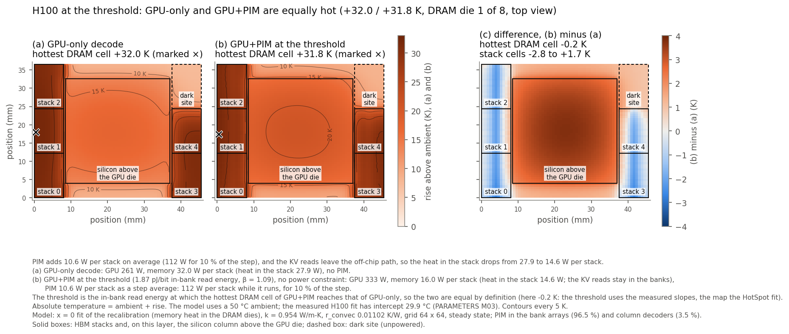

# hbm-pim-thermal-model

Model of near-bank processing-in-memory (PIM) in the HBM of a GPU during LLM decoding. It simulates
bank-level PIM (AttAcc) on H100, H200 and B200 HBM, turns the result into power per stack, and puts that power into a
HotSpot model of the H100 package calibrated to HBM temperatures measured on an H100. The output is the heat factor β:
how many watts of ordinary memory power heat the HBM as much as one watt of PIM power.

```
dram/     AttAcc + Ramulator 2 ──► PIM bandwidth and power per stack, refresh slowdown
          HBM-Power (35 HBM2 chips, HBM3E model) ──► IDD7 stack power;  DRAMPower ──► bank power map
thermal/  measured H100 slopes ──► HotSpot package model (5 stacks): heat-sink resistance, bond k, base-die share x
          PIM heat in the bank arrays and MAC units ──► β at x = 0;  measured row-miss ratio ──► x ──► matched β
tools/    check_params.py: the values in the parameter tables and below equal the code and data the model reads
```

## Quick start

```bash
pip install -r requirements.txt   # numpy, matplotlib
make check                        # DRAM values, HotSpot build, measured fits, one HotSpot run, tables
make quick                        # + calibration, bank model (grid 64), recalibration, β
make figures                      # redraw figures/ from the HotSpot runs
```

`check`, `quick` and `full` end with `python3 -m dram.check`, `python3 -m thermal.check` and `tools/check_params.py`, and
exit 1 on a mismatch. `make full` also rebuilds AttAcc, reruns every DRAM simulation and runs the thermal model on grid
128. `make check-params` runs the table check alone. `WORKERS` (default 8) sets parallel HotSpot runs; times below.

## Figures

| figure | shows |
|---|---|
| [package](figures/thermal_package.png) | H100 package floorplan: GPU die, five powered HBM stacks and one dark site |
| [DRAM die](figures/thermal_dram_die.png) | one DRAM die: 128 banks as 64 two-bank cells, TSV stripe, two channels, one pseudo channel marked |
| [heatmap](figures/thermal_heatmap.png) | hottest DRAM die, rise above ambient: H100 GPU-only decode against GPU+PIM at the threshold (x = 0 fit), and the difference; the hottest cells match (32.0 / 31.8 K) |
| [stack layers](figures/thermal_stack_layers.png) | hottest stack, GPU+PIM at the threshold: base die and the eight DRAM dies, rise above ambient |
| [calibration](figures/thermal_calibration.png) | row-miss ratio and β against the base-die share x; the measured ratio picks x |



## Reproduced values

H100 / H200 / B200 where three values are given; PIM values are per stack. Values marked full are those of the analysis
behind the paper; of `make full`, only the grid-128 bank model was run here (from cached runs, f_bank 1.1145 against
1.1146). All checked values with tolerances:
[`dram/results/reference.json`](dram/results/reference.json), [`thermal/results/reference.json`](thermal/results/reference.json).

| quantity | value | target | script |
|---|---|---|---|
| PIM bandwidth at the power-constrained MAC interval (AttAcc's 6 / 7 clocks; 9 is ours) | 5.38 / 5.72 / 5.45 TB/s | check | [`dram/attacc/pim_table.py`](dram/attacc/pim_table.py), from `mac_sweep.py` |
| PIM power there | 24.5 / 26.1 / 24.8 W | check | same |
| PIM bandwidth at tCCD_L | 7.40 / 8.83 / 8.90 TB/s | check | same |
| PIM energy: in-bank read, MAC | 0.55 pJ/bit, 0.32 pJ/MAC | check | same (AttAcc energy table) |
| busiest channel over mean, κ (H100) | 1.06 | check | same |
| slowdown at doubled all-bank refresh: GPU (analytic); PIM (simulated) | 1.109 / 1.133 / 1.133; 1.109 / 1.135 / 1.133 | check | same; PIM from [`refresh_sweep.py`](dram/attacc/refresh_sweep.py) |
| IDD7 stack power from 35 HBM2 chips | 1.10-1.51x PIM power (H100); max 37.2 / 41.2 / 40.7 W | check | [`dram/hbm_power/idd7_chips.py`](dram/hbm_power/idd7_chips.py) |
| DRAM background power per stack (bank power map) | 23.9 W | check | [`dram/bank_power/stack_power.py`](dram/bank_power/stack_power.py) |
| HBM rise per non-memory W / memory W (measured) | 0.0226 / 0.1877 K/W | check | [`thermal/steps/measured.py`](thermal/steps/measured.py) |
| row-miss heating ratio (measured, 95 % CI) | 0.70 (0.63-0.78) | check | same |
| heat-sink resistance r_convec (k = 1) | 0.01361 K/W | quick | [`thermal/steps/calibrate.py`](thermal/steps/calibrate.py) |
| temperature ripple within a decode step, per layer | 0.055 K | quick | [`thermal/steps/bank.py`](thermal/steps/bank.py) |
| β, PIM at every bank, x = 0 (range over floorplans and MAC share) | 1.088 (1.026-1.132) | quick | [`thermal/steps/beta.py`](thermal/steps/beta.py) |
| β, PIM in half / a quarter of the channels, x = 0 | 1.51-1.80 / 1.75-2.86 | quick | same |
| H100 threshold where β is evaluated (in-bank read energy) | 1.872 pJ/bit | quick | same |
| β at x = 1 | 0.668 | quick | [`thermal/steps/recal.py`](thermal/steps/recal.py) |
| x matching the row-miss ratio; β there (over the CI) | 0.975; 0.674 (0.668-0.736) | quick | same |
| same, die-average readout (bottom DRAM die / base die) | 0.686 / 0.517; 0.748 / 0.807 | quick | same |
| same, base-die heat on the GPU-side half | 0.357; 0.669 | quick | same |

Models: the x = 0 fit (k 0.954, all memory heat in the DRAM dies; the highest β, shown in the heatmap) and the matched
fit (x 0.975, k 1.927; matched β). Steps 2-3 (calibration, bank model, ripple) use bond k = 1.

β is the memory power that raises the peak DRAM temperature (hottest DRAM grid cell) as much as the PIM power does,
divided by the PIM power. The memory power is placed like the model's memory heat (share x in the base die, the rest
over the DRAM dies); PIM heat goes to every bank (bank arrays 96.5 %, column decoders 3.5 %) unless a row names a channel
subset.

β is evaluated at the H100 GPU+PIM operating point at the threshold with no power constraint that this β gives
(fixed-point iteration, [`thermal/model/beta.py`](thermal/model/beta.py); operating points from the analysis repository
in [`thermal/data/inputs/beta_operating_points.json`](thermal/data/inputs/beta_operating_points.json)). One value per
PIM distribution and split serves H100, H200 and B200; their own operating points move it by 0.2 % at x = 0 (direct
runs; 0.5 % from the family interpolation).

| comparison only, not used | x = 0 | matched x |
|---|---|---|
| comparison normalisations: f_bank (k = 1, GPU 80 W, PIM rise over uniform DRAM-die power) / local slope at the fixed 1.84 pJ/bit point | 1.120 / 1.128 | - / 0.661 |

Not recomputed by `make`: the package and GPU-side variants, the second H100 card and the grid-128 refit (recorded in
[`thermal/checks/`](thermal/checks/README.md), with the local-slope normalisation), and the GPU-side decode model
behind the operating points (analysis repository, not included).

## Repository

```
dram/      DRAM/PIM simulation, IDD7 data, bank power map     README.md, PARAMETERS.md
thermal/   HotSpot package model, calibration, β               README.md, PARAMETERS.md, checks/
tools/     check_params.py (tables against code and data), export_beta_ops.py
figures/   PNGs above (make figures);  sources.bib, NOTICE.md (third-party licenses)
```

## Requirements and runtimes

Tested on macOS 26 (Apple M5, 10 cores, Apple clang 21) with Python 3.9+, numpy >= 1.17 and matplotlib >= 3.3; also
git, make, a C compiler and network access for the HBM-Power data (about 31 MB). `make full` also needs cmake >= 3.14 and a C++20
compiler. Times were taken with other jobs running. One HotSpot run takes 45-90 s on grid 64, 280-450 s on grid 128.

| target | time | work |
|---|---|---|
| `make check` | ~1 min | DRAM derived values, HotSpot build, 1 HotSpot run, table check |
| `make quick` | ~35 min | 198 HotSpot runs (a rerun reuses cached runs: under 1 min) |
| `make full` | ~2 h | AttAcc build and all DRAM simulations (~33 min); about 445 HotSpot runs (~1.5 h, estimate) |
| `make figures` | < 5 s | none (reads cached runs) |

## Provenance

Every power value, parameter, hyperparameter and modelling choice is listed with its source, its status and the effect
of the alternatives that were run: [PARAMETERS.md](PARAMETERS.md). Measured data are our H100, H200 and B200 runs
(nvidia-smi), described in [`thermal/data/SOURCES.md`](thermal/data/SOURCES.md) and
[`dram/data/measured_copy_power.json`](dram/data/measured_copy_power.json). Third-party code: [NOTICE.md](NOTICE.md).

## References

Full list with pinned commits and locations: [sources.bib](sources.bib). Main sources:

- J. Park et al., AttAcc! Unleashing the Power of PIM for Batched Transformer-based Generative Model Inference,
  ASPLOS 2024. [scale-snu/attacc_simulator](https://github.com/scale-snu/attacc_simulator)
- A. Olgun et al., Understanding the Power Consumption of Modern High Bandwidth Memory, arXiv:2610.14244 (MICRO 2026).
  [CMU-SAFARI/HBM-Power](https://github.com/CMU-SAFARI/HBM-Power)
- R. Zhang, M. R. Stan, K. Skadron, HotSpot 6.0: Validation, Acceleration and Extension, UVA CS-2015-04; package setup
  from J. Hong et al., HPCA 2024.
