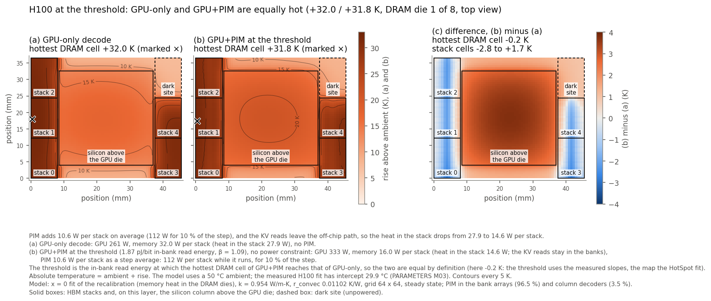

# thermal: H100 package model in HotSpot

HotSpot 6.0 model of the H100 package (GPU die, five 8-high HBM stacks) calibrated to temperatures measured on an
H100. It gives the heat factor beta of PIM (the memory power that heats the HBM as much as the PIM power does, per W of
PIM power), its range over floorplans, channel subsets, memory-power splits and sensor readouts, and the temperature ripple
within a decode step. Every parameter and its source: [PARAMETERS.md](PARAMETERS.md). Audit evidence: [checks/](checks/README.md).

```
data/measured ──fit──► a_G, a_M, row-miss ratio                                 steps/measured.py
geometry + HotSpot ──► r_convec fitted to the measured slope (bond k = 1)       steps/calibrate.py
bank floorplans ──unit responses──► f_bank (comparison), base die, ripple       steps/bank.py
k x r x sources ──replay measured points──► x, k, r family ─► beta(x), readouts steps/recal.py
x = 0 point ──direct runs──► beta, floorplans, MAC share, channel subsets       steps/beta.py
out/*.json ──► python3 -m thermal.check (results/reference.json), python3 -m thermal.figures
```

## Run

From the repository root (Python 3.9+, numpy, matplotlib, make, a C compiler):

```
python3 -m thermal check      # builds HotSpot, measured fits, one HotSpot run
python3 -m thermal quick      # + calibration, bank model on grid 64, recalibration, die-average readouts, beta
python3 -m thermal full       # + grid 128, 100 ms ripple window, all k and subsets
python3 -m thermal.figures    # PNGs into figures/ (from the cached runs)
```

Each mode ends with `python3 -m thermal.check`. `WORKERS` (default 8) sets parallel HotSpot runs; runs are cached in
`thermal/runs/` (`THERMAL_RUNS`), results go to `thermal/out/` (`THERMAL_OUT`). A rerun skips finished runs.

| mode | HotSpot runs | wall time (Apple M5, 8 workers, other jobs running) |
|---|---|---|
| check | 1 | 1.2 min |
| quick | 198: calibration 7, bank 28 (8 transient), recalibration 144, beta 19 | about 35 min (4 + 9 + 17, readouts 2, beta 5) |
| full | quick + bank 25 (grid 128, 1000-row transients) + recalibration 216 + beta 5 (grid 128) | about 1.5 h (estimate) |

One run: grid 64 steady 45-90 s, grid 128 steady 280-450 s, transient 300 rows about 400 s, 1000 rows about 920 s.

## beta

beta is the memory power that raises the peak DRAM temperature as much as the PIM power does, divided by the PIM power;
the memory power is split like the fit's memory heat (x base die, 1 - x DRAM dies). It is evaluated at the H100 GPU+PIM
operating point at the threshold with no power constraint that this beta gives (`model/beta.py`, fixed point in 3-6
steps, operating points `data/inputs/beta_operating_points.json`), and one value per split serves all three GPUs.

| comparison only, not used | normalised by | operating point | x = 0 | matched x |
|---|---|---|---|---|
| f_bank (`steps/bank.py`) / local (`steps/recal.py` betas()) | uniform DRAM-die power of the same amplitude / local memory slope ±20 W | GPU 80 W, k = 1 / fixed P_G 332.7 W, P_M 80.1 W, P_P 52.1 W | 1.120 / 1.128 | - / 0.661 |

On the same grid (64) the two comparison values differ by 0.7 %, through k (1 against 0.954), r_convec (0.01361
against 0.01102), the operating point and the normaliser.

## Values

paper: as printed. quick: computed here (`out/`, mode quick). full: the values behind the paper, from the analysis
repository; `results/reference.json` holds them with tolerances (96 values; 87 apply in quick mode). The grid-128 bank model was
run here from cached runs (`python3 -m thermal.steps.bank --grids 64,128`): f_bank 1.1145 against 1.1146.

| quantity | paper | quick | full | file |
|---|---|---|---|---|
| HBM rise per non-memory / memory W (K/W) | 0.0226 / 0.1877 | 0.02259 / 0.18774 | = quick | `out/measured.json` |
| row-miss heating ratio, 95 % CI | 0.70 (0.63-0.78) | 0.701 (0.633-0.779) | = quick | `out/measured.json` |
| heat-sink resistance r_convec at k = 1 (K/W) | | 0.01361 | = quick | `out/calibrate.json` |
| beta, PIM at every bank, x = 0 | 1.09 | 1.088 | 1.088 | `out/beta.json` |
| beta range (array share, orientation, MAC share) | 1.03-1.13 | 1.026-1.132 | 1.026-1.132 | `out/beta.json` |
| beta, half / quarter of the channels, x = 0 | 1.51-1.80 / 1.75-2.86 | 1.508-1.802 / 1.751-2.858 | = quick | `out/beta.json` |
| H100 threshold where beta is evaluated (pJ/bit), x = 0 / matched x | | 1.872 / 3.038 | = quick | `out/beta.json`, `out/recal.json` |
| base-die W over DRAM-die W (peak DRAM rise) | 1.7 | 1.742 | 1.742 | `out/bank.json` |
| ripple, per-layer PIM bursts (K) | 0.06, bound 0.1 | 0.0550 | 0.0549 | `out/bank.json` |
| beta at base-die share x = 0 (family) / x = 1 | 1.09 / 0.67 | 1.088 / 0.668 | = quick | `out/recal.json` |
| x matching the row-miss ratio, beta there | 98 %, 0.67 | 0.975, 0.674 | = quick | `out/recal.json` |
| same, half / quarter of the channels | 0.93-1.14 / 1.07-1.86 | | 0.935-1.145 / 1.075-1.859 | `out/recal.json` (full) |
| beta for x with ratio inside the CI | 0.67-0.74 | 0.668-0.736 | = quick | `out/recal.json` |
| same, base-die power on the GPU side: x, beta | 36 %, 0.67 | 0.357, 0.669 | = quick | `out/recal.json` |
| die-average sensor (bottom die / base die): x, beta | 69 % / 52 %, 0.75 / 0.81 | 0.686 / 0.517, 0.748 / 0.807 | = quick | `out/recal.json` |
| reference only, not in the paper: x from our HBM3E I/O-and-TSV lower bound, beta | | 0.165, 0.982 | = quick | `out/recal.json` |

The matched x depends on the grid (0.975 at 64, 0.90 at 128) while its beta moves by 0.3 %
(`checks/numerics/out_best_xscan_g64_g128.json`). quick runs the recalibration over k = 0.75-2.0, which holds every
interpolation row the recalibrated values use, so they equal full.

Not recomputed by `make`/`python3 -m thermal`: the package and GPU-side variants (beta 0.65-0.70, beta over ratio
0.93-0.96), the second H100 card (0.74) and the grid-128 refit are recorded results in `checks/`, made with the
local-slope normalisation (comparison only); the GPU-side operating points come from the analysis repository (not
included).



Hottest DRAM die (die 1) as rise above ambient: (a) H100 GPU-only decode (GPU 261 W, memory 32.0 W per stack), (b)
GPU+PIM at the threshold where beta is evaluated (1.87 pJ/bit, no power constraint: GPU 333 W, memory 16.0 W per stack,
PIM 10.6 W per stack as a step average, 112 W per stack while it runs for 10 % of the step), (c) (b) minus (a). The
threshold makes the hottest cells equal (32.0 / 31.8 K: the threshold uses the measured slopes, the map the HotSpot
fit); GPU+PIM is warmer above the GPU die and cooler in most of the stacks. Absolute temperature = ambient (50 °C in the
model) + rise; the measured H100 fit has intercept 29.9 °C (M03). Model: the x = 0 fit (k 0.954, r 0.01102), the split
with the highest beta, so the map shows the largest PIM heating of the fitted family; the matched fit (x 0.975, beta
0.674) puts most memory heat in the base die. Superposition of the unit responses of the beta step; grid 128 after
`make full`, grid 64 after `make quick` only (the caption prints the grid).

## Fixed model values

| item | value | basis |
|---|---|---|
| layers, bottom to top | interposer Si 50 µm; bond 20 µm; GPU die and base dies Si 50 µm; 8 x (bond 20 µm, DRAM die Si 50 µm); TIM 20 µm (k 4, `stack.lcf` layer 19); spreader 1 mm and sink 6.9 mm (k 400) | HotSpot-HMS model files of Hong et al.; their Table II for Si and spreader |
| bond conductivity | fitted k in bond layers 3, 5, ..., 17 inside the stack footprints; k 4 elsewhere; silicon column above the GPU die in every layer | k = 1 in steps 2-3 (calibration, bank model): near the x = 0 fit (k 0.954), whose row-miss ratio 1.18 lies above the measured CI; the x = 0 fit gives the highest beta (1.088 against 0.668-0.736 for x in the CI, one beta definition) |
| package box | ends at the outer stack edges; sides adiabatic; top cooling only (secondary path off) | so the hottest cell sits at the outer die edge (0.14-0.36 mm from it) |
| GPU power | all non-memory power uniform over the GPU die block C_0 (28.53 mm square, 814 mm²) | H100 whitepaper p.17 (area); no public power map |
| memory power | share 1 - x uniform over the eight DRAM dies, x over the base die; x = 0 in steps 2-3 | x fitted in step 4 |
| ambient | 50 °C | Hong et al. Table II; the model is linear, so slopes and beta do not depend on it |
| r_convec | 0.01361 K/W at k = 1 (steps 2-3); refitted per (k, x) in step 4 | measured anchor slope 0.04328 K per board W |

## Assumptions and readouts

- Readouts: step 2 reads the hottest 2 x 2 block centre (HotSpot `grid_map_mode center`); steps 3-4 read the hottest
  DRAM grid cell. A die-average sensor (bottom DRAM die or base die of the hottest stack) in the fit gives beta
  0.75-0.81 instead of 0.67 (`out/recal.json` die_average).
- Top cooling only: a bottom path (0.5 K/W, 60 mm substrate) moves the matched beta by -0.001.
- Steady solver: HotSpot's iterative solver stopping at 1e-6 K instead of the direct solver its report recommends;
  1e-10 differs by 0.01 K, one output step (`checks/numerics/tol_summary.json`).
- GPU die square and uniform: power in the central 70 % of the die gives matched beta 0.671 instead of 0.661 (local
  slope, `checks/variants`).
- Stack footprint 8.0 x 12.19 mm from HotSpot-HMS (HBM3E is about 10 x 11 mm); no sensitivity run.
- Dark site top right (H100 powers 5 of 6 sites); it decides which stack is hottest, not the per-stack beta.
- c_convec 173.82 J/K is not rescaled to the 82.1 mm sink (the rule gives 262.88); transient only, and the ripple bound
  stays conservative (HotSpot reaches 63 % of an HBM step in 0.46 s, the measurement in 14-18 s).

Effect of each assumption on beta: `PARAMETERS.md`.

## Layout

```
thermal/
├── hotspot/          HotSpot 6.0 source with the all-layer grid dump (layer-dump.patch), LICENSE (UVA)
├── geometry/         build_5stack.py -> h100_5stack/ (floorplans, layer stack), h100_5stack.config
├── data/             measured/ (H100 CSVs), inputs/ (operating points, DRAM map, GPU-side inputs), SOURCES.md
├── model/            geom, power, hotspot (runner + cache), readout, modal (transient fit), measured, beta
├── steps/            measured, calibrate, bank, recal, beta  (python3 -m thermal.steps.<name>)
├── checks/           audit evidence (JSON + scripts) cited in PARAMETERS.md
├── results/          reference.json
├── PARAMETERS.md     every parameter with value, source, status and effect on beta
├── check.py          python3 -m thermal.check
└── figures.py        python3 -m thermal.figures
```

## Model in brief

- DRAM die: the 128 banks of two HBM3 channels (64 each), modelled as 64 two-bank cells. A half is one channel
  (32 cells), a quadrant one pseudo channel (16 cells, 32 banks). PIM heat goes to the bank arrays, its MAC share
  (3.5 %) to the column decoders.
- Spreader and sink thickness and materials as in HotSpot-HMS; sides sized for the H100 package (45.6 / 82.1 mm).
- HotSpot is linear here (leakage off), so each run is a unit response of one source and every case is a superposition
  (superposition against one joint run: 0.009 K).
- Recalibration: memory power split between base die (share x) and DRAM dies; k, r and x fitted to both measured
  slopes; the HotSpot replay of the row-miss run picks x.

## References

- W. Huang et al., HotSpot: A Compact Thermal Modeling Methodology for Early-Stage VLSI Design, IEEE TVLSI 2006.
- R. Zhang, M. R. Stan, K. Skadron, HotSpot 6.0: Validation, Acceleration and Extension, Univ. of Virginia tech. report, 2015.
- J. Hong et al., Bandwidth-Effective DRAM Cache for GPUs with Storage-Class Memory, HPCA 2024 (package setup).
- J. Park et al., AttAcc! Unleashing the Power of PIM for Batched Transformer-based Generative Model Inference, ASPLOS 2024.
- A. Olgun et al., Understanding the Power Consumption of Modern High Bandwidth Memory, 2026 (HBM-Power model).
